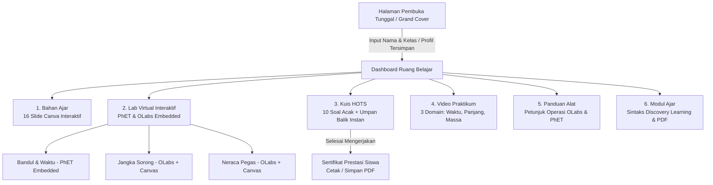

# 🧪 Lab Virtual IPA: Petualangan Pengukuran (Kelas VII SMP)

[](https://kemdikbud.go.id)
[](https://developer.mozilla.org/en-US/docs/Web/Progressive_web_apps)
[](https://phet.colorado.edu)
[](https://hostinger.co.id)

Media Pembelajaran Interaktif IPA SMP/MTs Berbasis Web Modern & Progressive Web App (PWA). Dirancang khusus untuk pembelajaran materi **Pengukuran, Besaran, dan Satuan Pokok SI** sesuai Capaian Pembelajaran (CP) Fase D Kurikulum Merdeka dengan model *Discovery Learning*.

Aplikasi ini menggabungkan simulasi laboratorium nyata (**PhET Pendulum Lab & Amrita OLabs**), video praktikum terarah, bahan ajar interaktif, naskah modul ajar resmi, serta evaluasi kuis penalaran tingkat tinggi (HOTS) dengan umpan balik instan dan sertifikat kelulusan siswa.

---

## 🧭 Alur Konsep & Navigasi Aplikasi



---

## 🌟 6 Pilar Pembelajaran Utama

### 1. Halaman Pembuka Tunggal (*Unified Cover Screen*)
- **Desain Papan Kayu Gantung Interaktif** bergaya petualangan alam dan sains.
- **Satu Layar Terpadu**: Tidak ada halaman ganda (*double cover*) dan tanpa tombol navigasi yang membingungkan.
- **Deteksi Profil Otomatis**: Jika siswa sudah pernah masuk, sistem menyapa nama siswa dengan tombol *"Lanjutkan Petualangan!"*. Jika siswa baru atau ingin berganti identitas, formulir input nama, kelas, no. absen, dan sekolah dapat diisi langsung di halaman utama.

### 2. Bahan Ajar Interaktif (16 Slide Canva)
- Menampilkan visual materi besaran pokok, satuan standar internasional (SI), alat ukur, dan konversi satuan.
- Dilengkapi navigasi panah, *auto-play slide*, dan thumbnail panel.

### 3. Lab Virtual Interaktif (*Embedded Real Simulator*)
- **Pengukuran Waktu (PhET Interactive Pendulum Lab)**:
  - Berjalan **langsung di dalam aplikasi (*in-app embedded iframe*)** tanpa mengarahkan siswa keluar ke web eksternal.
  - Dilengkapi mode bandul kanvas offline 60 FPS dengan stopwatch digital dan rumus periode $T = t/n$.
- **Pengukuran Panjang (Jangka Sorong)**:
  - Terintegrasi simulasi Amrita OLabs Jangka Sorong dan kanvas interaktif dengan rahang geser draggable, penghitungan skala utama (SU) dan skala nonius (SN).
- **Pengukuran Massa & Gaya (Neraca Pegas)**:
  - Terintegrasi simulasi Amrita OLabs Neraca Pegas dan kanvas elastisitas dengan pengubah percepatan gravitasi planet (Bumi, Bulan, Mars, Jupiter) serta pembuktian rumus $M = w/g$.

### 4. Video Praktikum (3 Domain Pengukuran)
- **Tab 1: Pengukuran Waktu**: Video panduan praktikum ayunan bandul dan penggunaan stopwatch.
- **Tab 2: Pengukuran Panjang**: Panduan pengukuran tebal dan diameter dalam/luar dengan jangka sorong.
- **Tab 3: Pengukuran Massa**: Panduan penimbangan beban menggunakan neraca pegas.

### 5. Panduan Alat & Modul Ajar Kurikulum Merdeka
- Naskah modul ajar lengkap untuk guru dan peserta didik berbasis *Discovery Learning*.
- Akses dan unduh dokumen PDF asli:
  - *Modul Ajar Pengukuran.pdf*
  - *Bahan Ajar Pengukuran.pdf*
  - *User Guide Praktikum Virtual Jangka Sorong.pdf*
  - *User Guide Praktikum Virtual Neraca Pegas.pdf*
  - *User Guide Pengukuran Waktu.pdf*
  - *KUIS MATERI PENGUKURAN KELAS VII.pdf*

### 6. Kuis HOTS & Sertifikat Prestasi Siswa
- 10 Soal penalaran tingkat tinggi (Higher Order Thinking Skills).
- **Soal dan Pilihan Diacak (*Randomized*)** setiap sesi agar siswa tidak saling menyontek.
- **Umpan Balik Langsung (*Instant Feedback*)**: Begitu siswa memilih jawaban, sistem langsung menampilkan koreksi (Benar/Salah), kunci jawaban yang benar, serta penjelasan ilmiah lengkap.
- **Sertifikat Kelulusan Resmi**: Menampilkan nama siswa, kelas, skor akhir, predikat kelulusan, dan tanggal pelaksanaan yang dapat langsung dicetak atau disimpan sebagai PDF.

---

## 🌐 Panduan Deployment

### Opsi 1: Deploy ke Hostinger (Web Hosting / Shared Hosting) — SANGAT DIREKOMENDASIKAN ⭐

> **Apakah aplikasi ini bisa langsung running di Hostinger Web Hosting biasa (tanpa VPS)?**  
> **YA, BISA 100%!**  
> Aplikasi ini dibangun murni menggunakan **HTML5, CSS3, dan Vanilla JavaScript (Client-side PWA)**. Tidak membutuhkan runtime Node.js, Python, ataupun database server di sisi hosting. Seluruh data identitas dan kuis disimpan aman di browser masing-masing siswa (`localStorage`).

#### Langkah-langkah Deploy ke Hostinger:
1. Login ke panel Hostinger (**hPanel**).
2. Masuk ke menu **Websites** ➔ pilih domain Anda ➔ buka **File Manager**.
3. Buka folder **`public_html`**.
4. Upload seluruh file dari repositori ini ke dalam folder `public_html/`:
   - `index.html`
   - Folder `css/`
   - Folder `js/`
   - File manifest & service worker (`manifest.json`, `sw.js`)
   - File video (`.mp4`) dan dokumen materi (`.pdf`)
5. Selesai! Buka nama domain Anda di browser. Media pembelajaran langsung aktif, berkecepatan tinggi berkat web server LiteSpeed Hostinger, dan otomatis terenkripsi SSL HTTPS.

---

### Opsi 2: Deploy Menggunakan Docker & Cloudflare Tunnel

Jika Anda ingin menjalankan aplikasi di server lokal sekolah (PC server lab komputer) lalu menghubungkannya ke internet publik secara gratis dan aman:

#### 1. Jalankan dengan Docker Compose
Pastikan Docker sudah terpasang, lalu jalankan perintah:

```bash
docker compose up -d --build
```

Aplikasi akan berjalan pada port **8080** (`http://localhost:8080`).

#### 2. Sambungkan dengan Cloudflare Tunnel
1. Pasang CLI Cloudflare:
   ```bash
   # Di Linux / Mac / Windows
   cloudflared tunnel login
   ```
2. Buat tunnel baru:
   ```bash
   cloudflared tunnel create lab-ipa-tunnel
   ```
3. Arahkan traffic ke port lokal Docker:
   ```bash
   cloudflared tunnel route dns lab-ipa-tunnel lab.sekolahanda.sch.id
   cloudflared tunnel run --url http://localhost:8080 lab-ipa-tunnel
   ```
Siswa dapat mengakses langsung melalui domain `https://lab.sekolahanda.sch.id`.

---

### Opsi 3: Menjalankan Secara Lokal di Windows (Offline)

1. Buka folder proyek.
2. Klik ganda (**Double Click**) file **`Buka_Aplikasi.bat`**.
3. Browser akan otomatis terbuka pada alamat `http://localhost:8080/index.html`.

---

## 📱 PWA & Akses Siswa via QR Code

- **Akses Cepat Siswa**: Guru cukup membuka menu **`📱 Bagi QR`** di bilah navigasi atas dan menampilkannya di layar proyektor kelas. Siswa memindai QR code menggunakan kamera HP untuk langsung masuk.
- **Pemasangan Offline (PWA)**: Klik tombol **`📥 Unduh App`** di bilah navigasi untuk memasang aplikasi ke layar beranda HP (*Add to Home Screen*) tanpa perlu mengunduh dari toko aplikasi.

---

## 📂 Struktur Repositori

```text
├── index.html                   # Entry point aplikasi utama (Single Unified Screen)
├── manifest.json                # Web App Manifest untuk PWA
├── sw.js                        # Service Worker untuk caching offline
├── Buka_Aplikasi.bat            # Script 1-klik buka aplikasi lokal di Windows
├── server.py                    # Server mini Python untuk pengujian lokal
├── Dockerfile                   # Docker build berbasis Nginx Alpine
├── docker-compose.yml           # Orkestrasi container Docker lokal
├── nginx.conf                   # Konfigurasi Nginx produksi & MIME types
├── css/
│   └── style.css                # Desain visual game, papan kayu, responsif & animasi
├── js/
│   ├── app.js                   # Navigasi layar terpadu, identitas siswa, PWA, audio
│   ├── virtual-lab.js           # Engine simulasi Jangka Sorong, Neraca Pegas, PhET Bandul
│   ├── quiz.js                  # Soal HOTS acak, umpan balik instan & sertifikat
│   ├── audio.js                 # Efek suara interaktif Web Audio API
│   └── qrcode.min.js            # Generator QR Code otomatis
├── Video Panduan Praktikum Pengukuran Waktu.mp4
├── Modul Ajar Pengukuran.pdf
├── Bahan Ajar Pengukuran.pdf
├── User Guide Praktikum Virtual Jangka Sorong.pdf
├── User Guide Praktikum Virtual Neraca Pegas.pdf
├── User Guide Pengukuran Waktu.pdf
└── KUIS MATERI PENGUKURAN KELAS VII.pdf
```

---

## 👨‍🏫 Informasi Pengembang & Kurikulum
- **Mata Pelajaran**: Ilmu Pengetahuan Alam (IPA)
- **Fase / Kelas**: Fase D / Kelas VII SMP & MTs
- **Tema Materi**: Hakikat Sains, Pengukuran, Besaran Pokok & Satuan SI
- **Model Pembelajaran**: Discovery Learning & Inkuiri Terbimbing
