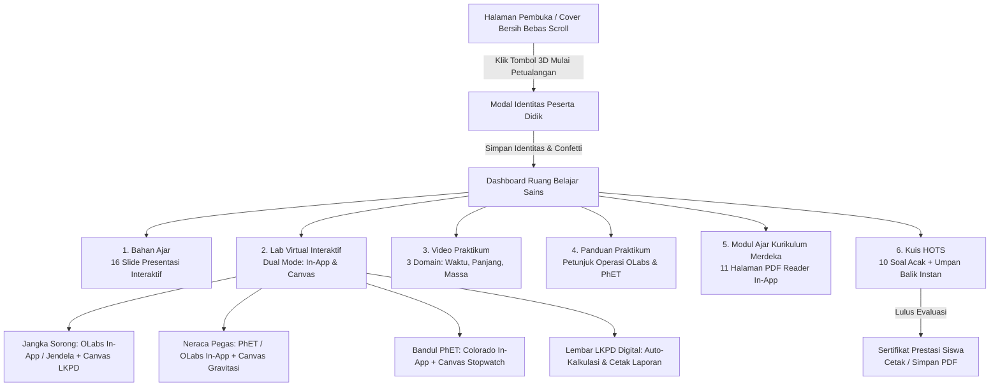

# 🧪 Lab Virtual IPA: Petualangan Pengukuran (Kelas VII SMP)

[](https://kemdikbud.go.id)
[](https://developer.mozilla.org/en-US/docs/Web/Progressive_web_apps)
[](https://phet.colorado.edu)
[](https://github.com/salman-mustapa/projects-01)

Media Pembelajaran Interaktif IPA SMP/MTs Berbasis Web Modern & Progressive Web App (PWA). Dirancang khusus untuk pembelajaran materi **Pengukuran, Besaran, dan Satuan Pokok SI** sesuai Capaian Pembelajaran (CP) Fase D Kurikulum Merdeka dengan model *Discovery Learning*.

Aplikasi ini menggabungkan simulasi laboratorium nyata (**PhET Interactive Simulations & Amrita OLabs**), video praktikum terarah, bahan ajar interaktif, naskah modul ajar resmi (11 halaman), lembar LKPD digital terintegrasi, serta evaluasi kuis penalaran tingkat tinggi (HOTS) dengan umpan balik instan dan sertifikat kelulusan siswa.

---

## 🧭 Alur Konsep & Navigasi Aplikasi



---

## 🌟 Fitur Unggulan Media Pembelajaran

### 1. Halaman Pembuka Estetik Bebas Scroll (*Zero-Scroll Cover*)
- **Desain Papan Kayu Gantung Interaktif** bertema rimbun alam dan sains (*deep emerald forest*) dengan pancaran cahaya *sunbeam*, kanopi daun, dan efek kedalaman visual.
- **Bebas Scrollbar (100% Viewport-Fitted)**: Halaman pembuka langsung pas di layar komputer, tablet, maupun layar HP tanpa perlu di-scroll ke bawah.
- **Alur Onboarding Bertahap**: Halaman depan bersih tanpa form input yang mengganggu. Siswa menekan tombol 3D **"MULAI PETUALANGAN"**, lalu muncul pop-up modal dialog modern untuk mengisi Nama Lengkap, Kelas, No. Absen, dan Sekolah.
- **Sesi Otomatis**: Jika siswa sudah terdaftar, tombol utama berubah menjadi *"LANJUTKAN: [NAMA SISWA]!"*, dan tersedia tombol *"Ganti Siswa"* di navbar untuk mereset sesi.

---

### 2. Laboratorium Virtual Terintegrasi (*Dual-Mode Virtual Lab*)
Setiap domain pengukuran dilengkapi sistem **Dual-Mode** (seperti yang terdapat pada PhET Bandul):

#### A. Pengukuran Panjang (Jangka Sorong)
1. **Mode 1: 🌐 Simulasi OLabs In-App Edition (Tersemat 100% di Iframe)**:
   - Tersemat langsung di dalam iframe aplikasi tanpa blank screen dan 100% interaktif di semua Web Hosting maupun lokal!
   - **Tampilan & Fitur Identik OLabs**: Desain papan kerja bertekstur, jangka sorong baja presisi, menu objek uji (*Sphere, Iron block, Beaker, Cylinder, Manual Drag*), HUD Kaca Pembesar Zoom (*Vernier Coincidence* dengan garis merah berimpit), pembacaan M.S.R (SU) & V.S.R (SN), tombol gerak mikro ±0.01 cm, serta tombol **"Catat ke LKPD"** yang otomatis mengirim data pengukuran ke lembar kerja siswa.
   - Tersedia tombol cepat beralih ke **Portal Resmi OLabs (olabs.edu.in)** dengan bantuan jendela interaktif.
2. **Mode 2: 🔬 Simulasi Canvas Interaktif (100% Offline & LKPD)**:
   - Mengukur 3 dimensi: **Diameter Luar**, **Diameter Dalam**, dan **Kedalaman**.
   - Dilengkapi 6 pilihan objek uji (*Sphere/Kelereng, Iron Block, Beaker/Gelas Kimia, Silinder, Koin, Baut*).
   - Kotak **Kaca Pembesar Skala Nonius** untuk melihat garis berimpit dengan presisi 0,01 cm.
   - Tombol **"Catat Hasil ke LKPD Digital"** untuk mentransfer data langsung ke tabel lembar kerja.

#### B. Pengukuran Massa & Gaya (Neraca Pegas)
1. **Mode 1: 🌐 Simulasi PhET / OLabs (Tersemat In-App)**:
   - Terintegrasi simulator **PhET Masses & Springs** (HTML5 resmi tanpa pemblokiran frame) untuk menguji konstanta pegas, gaya regangan, dan osilasi massa.
   - Tersedia tombol cepat membuka **OLabs Helical Spring Balance**.
2. **Mode 2: 🔬 Simulasi Neraca Pegas Canvas (Offline)**:
   - Gantungkan beban uji (Silinder 250g, Kunci 60g, Balok 120g, Batu 320g).
   - Pengatur percepatan gravitasi planet: **Bumi (9,8 N/kg)**, **Bulan (1,6 N/kg)**, **Mars (3,7 N/kg)**, dan **Jupiter (24,8 N/kg)**.
   - Pembuktian rumus gaya berat $w = m \times g$ dan konversi massa $m = w / g$.

#### C. Pengukuran Waktu (Bandul Matematis & Stopwatch)
1. **Mode 1: 🌐 Simulasi PhET Colorado Resmi (Tersemat In-App)**:
   - Simulator PhET Pendulum Lab resmi tersemat langsung dengan grafik energi dan variasi panjang tali/massa.
2. **Mode 2: 🔬 Simulasi Bandul Canvas (Offline)**:
   - Gerak harmonik bandul 60 FPS dengan stopwatch digital dan pendeteksi otomatis 10 ayunan untuk menghitung periode $T = t / n$.

#### D. Lembar LKPD Digital Terintegrasi
- 3 Tabel praktikum otomatis: Pengukuran Panjang, Massa & Gaya, serta Waktu & Periode.
- Siswa dapat mengisi analisis data, kesimpulan, dan mencetak laporan praktikum beridentitas resmi guru/sekolah.

---

### 3. Bahan Ajar Interaktif (16 Slide Presentasi)
- Visualisasi materi hakikat fisika, besaran pokok, besaran turunan, dimensi, dan konversi satuan SI.
- Dilengkapi tombol panah, thumbnail strip, mode *auto-play*, dan tautan unduh dokumen PDF asli.

---

### 4. Modul Ajar Kurikulum Merdeka (11 Halaman Cinema Viewer)
- Penampil naskah modul ajar 11 halaman lengkap dengan thumbnail strip dan navigasi slide.
- Memuat capaian pembelajaran (TP), sintaks model *Discovery Learning*, dan profil pelajar Pancasila.

---

### 5. Kuis Penalaran HOTS & Sertifikat Prestasi Siswa
- **10 Soal Berbasis Masalah Nyata (HOTS)** dengan pengacakan otomatis urutan soal dan pilihan jawaban.
- **Umpan Balik Langsung**: Menjelaskan alasan ilmiah di balik setiap jawaban benar dan salah.
- **Sertifikat Kelulusan Cetak**: Dilengkapi nama siswa, kelas, skor, predikat (*Sangat Memuaskan / Terampil*), tanggal pengerjaan, dan QR Code verifikasi.

---

## 🚀 Panduan Menjalankan Aplikasi

Aplikasi ini dapat dijalankan melalui **Web Hosting biasa (cPanel/Shared Hosting)** maupun **Server Lokal menggunakan Docker**.

### Opsi A: Deploy ke Web Hosting (cPanel / Shared Hosting / Vercel / GitHub Pages) ⭐

> **Apakah aplikasi ini bisa running di Web Hosting biasa tanpa VPS/Docker?**  
> **YA, 100% BISA!**  
> Arsitektur aplikasi ini adalah **Pure Client-Side Web Application & PWA (HTML5, CSS3, ES6 JavaScript)**. Tidak membutuhkan server Node.js, Python, ataupun database SQL di sisi server. Semua data tersimpan aman di browser siswa (`localStorage`).

#### Cara Deploy ke cPanel / Shared Hosting:
1. Login ke cPanel / hPanel hosting Anda.
2. Buka menu **File Manager** ➔ masuk ke folder **`public_html/`**.
3. Upload seluruh file dan folder repositori ini ke dalam `public_html/`:
   - `index.html`
   - `manifest.json` dan `sw.js`
   - Folder `css/`
   - Folder `js/`
   - Folder `assets/`
   - Dokumen PDF & video MP4
4. Selesai! Buka domain Anda di browser (`https://domainanda.com`). Aplikasi langsung aktif dengan dukungan HTTPS dan PWA offline caching.

#### Cara Deploy ke GitHub Pages (Gratis):
1. Masuk ke tab **Settings** pada repositori GitHub ini.
2. Pilih menu **Pages** di panel kiri.
3. Pada bagian **Branch**, pilih `main` dan folder `/ (root)`, lalu klik **Save**.
4. Dalam 1-2 menit, aplikasi akan live di `https://username.github.io/repository-name/`.

---

### Opsi B: Menjalankan di Server Lokal / Docker Nginx 🐳

Jika Anda ingin menjalankan aplikasi di jaringan komputer laboratorium sekolah secara lokal tanpa internet:

1. **Jalankan via Docker Compose**:
   ```bash
   docker compose up -d --build
   ```
2. Buka peramban pada alamat:
   ```text
   http://localhost:8080
   ```
3. **Keunggulan Mode Docker Nginx**:
   Di dalam file `nginx.conf`, sudah dikonfigurasi reverse proxy `/olabs-proxy/` yang secara otomatis menghapus header `X-Frame-Options` dan CSP dari server OLabs. Ini memungkinkan simulator OLabs tampil 100% di dalam iframe tanpa diblokir oleh browser.

---

### Opsi C: Menjalankan Langsung di Komputer (Tanpa Server Apapun) 💻

1. Buka folder proyek.
2. Klik ganda (**Double Click**) file **`index.html`**.
3. Browser akan otomatis terbuka dan media pembelajaran langsung siap digunakan 100% interaktif!

---

## ❓ Seputar Tampilan Simulator OLabs & PhET

| Simulator | Mode Tersemat (In-App) | Mode Canvas (Offline) | Keterangan Akses |
| :--- | :---: | :---: | :--- |
| **PhET Pendulum Lab** | ✅ 100% Tersemat | ✅ Ada (Stopwatch 10 Ayunan) | Server PhET University of Colorado mengizinkan cross-origin embedding resmi. |
| **PhET Masses & Springs** | ✅ 100% Tersemat | ✅ Ada (Gravitasi Planet) | Simulasi resmi HTML5 berjalan mulus langsung di dalam aplikasi. |
| **OLabs Vernier Calipers** | ✅ 100% Tersemat (In-App HTML5 Edition) + Opsi Portal Resmi | ✅ Ada (Magnifier + 6 Objek) | Berjalan 100% mulus di iframe aplikasi pada Web Hosting maupun offline tanpa blank screen! Tersedia tombol cepat ke portal resmi. Pada Docker, Nginx Proxy mem-bypass batasan olabs.edu.in secara otomatis. |

---

## 📂 Struktur Repositori

```text
├── index.html                   # Entry point aplikasi utama (Responsive & Zero-Scroll)
├── manifest.json                # Web App Manifest untuk PWA
├── sw.js                        # Service Worker untuk caching offline
├── Dockerfile                   # Docker image berbasis Nginx Alpine
├── docker-compose.yml           # Konfigurasi container Docker lokal (Port 8080)
├── nginx.conf                   # Konfigurasi Nginx produksi & OLabs reverse-proxy
├── css/
│   └── style.css                # Desain visual game, background alam, tema kayu, responsif
├── js/
│   ├── app.js                   # Navigasi layar, modal siswa, sub-simulator switch, PWA, audio
│   ├── virtual-lab.js           # Engine simulasi Jangka Sorong, Neraca Pegas, & LKPD Digital
│   ├── quiz.js                  # Engine kuis HOTS acak, umpan balik instan & sertifikat
│   ├── audio.js                 # Efek suara interaktif Web Audio API sintetis
│   └── qrcode.min.js            # Generator QR Code otomatis
├── assets/
│   ├── slides/                  # 16 Slide bahan ajar visual
│   └── modul/                   # 11 Halaman modul ajar Kurikulum Merdeka
├── Video Panduan Praktikum Pengukuran Waktu.mp4
├── Modul Ajar Pengukuran.pdf
├── Bahan Ajar Pengukuran.pdf
├── User Guide Praktikum Virtual Jangka Sorong.pdf
├── User Guide Praktikum Virtual Neraca Pegas.pdf
├── User Guide Pengukuran Waktu.pdf
└── KUIS MATERI PENGUKURAN KELAS VII.pdf
```

---

## 👨‍🏫 Informasi Pengembang & Kurikulum
- **Mata Pelajaran**: Ilmu Pengetahuan Alam (IPA)
- **Fase / Kelas**: Fase D / Kelas VII SMP & MTs
- **Tema Materi**: Hakikat Sains, Pengukuran, Besaran Pokok & Satuan SI
- **Model Pembelajaran**: Discovery Learning & Inkuiri Terbimbing
